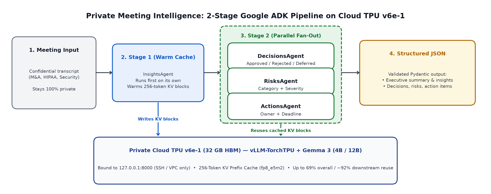
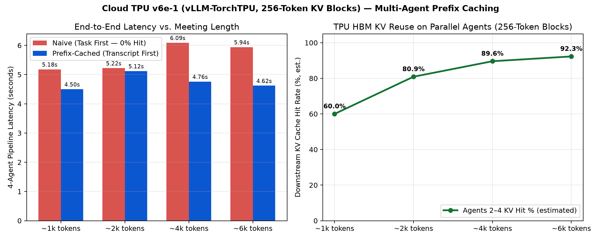
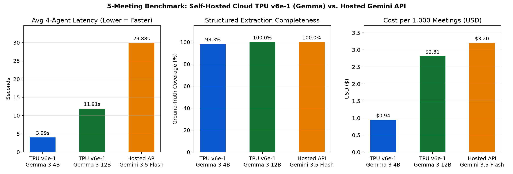
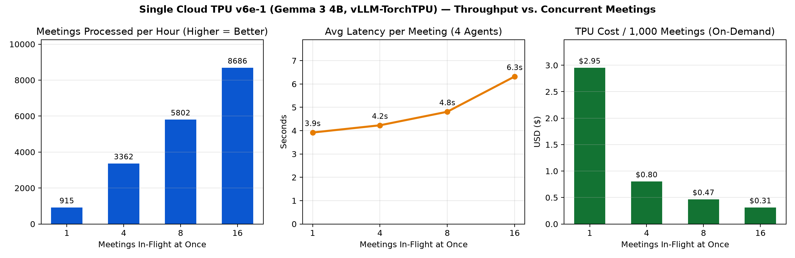

# Building a Private Multi-Agent Meeting Intelligence App on Cloud TPU v6e with vLLM-TorchTPU and Google ADK

*A step-by-step tutorial on serving open-weight Gemma 3 on a single Cloud TPU v6e chip, connecting four Google ADK agents to it, sharing transcript memory with prefix caching, and comparing speed and cost against a hosted API.*

---

## Why I Built This Project

Think about the most sensitive meetings inside any company: an unannounced acquisition, a security incident postmortem, a hospital compliance review, or a board pricing discussion. Everyone wants clean meeting summaries, decisions, risks, and action items afterward. The problem is that many legal and security teams will not allow those raw transcripts to be sent to a third-party AI API.

If you want to keep that data private, you have to host an open-weight model inside your own cloud project.

That brings up a second problem. Good meeting intelligence is rarely a single prompt. Usually you split the work across specialized agents: one agent writes the summary, one pulls out decisions, one flags risks, and one extracts action items with owners and deadlines. If all four agents read the same 6,000-token transcript from scratch, your hardware processes 24,000 input tokens for a single meeting. That wastes both time and compute.

I built this project during a Cloud TPU sprint to test three practical questions on real hardware:

1. How do you take an open-weight model (**Gemma 3**) from a fresh **Cloud TPU v6e** VM to a live, private serving endpoint using **vLLM-TorchTPU**?
2. How do you connect **Google ADK** to that endpoint and make four agents reuse the same transcript memory (**KV prefix caching**) instead of recomputing it four times?
3. How does a single Cloud TPU v6e-1 chip compare with a hosted cloud API (**Gemini 3.5 Flash**) on speed, output quality, throughput, and cost?

All code, synthetic meeting transcripts, charts, and raw benchmark JSON files are public on GitHub:  
**[github.com/geeta-gwalior/tpu-meeting-intelligence](https://github.com/geeta-gwalior/tpu-meeting-intelligence)**

---

## What Makes This Project Special (and Its Main Advantages)

Before jumping into the code, here is why this architecture works well in practice:

- **100% Data Privacy:** The model (`google/gemma-3-4b-it` or `google/gemma-3-12b-it`) runs on your own Cloud TPU VM and listens only on `127.0.0.1:8000`. Your client connects over a private SSH tunnel or internal VPC. No meeting text ever touches a public endpoint.
- **No Wasted Prefill Across Agents:** By putting the shared meeting transcript at the very top of every agent's prompt and warming the cache with the first agent, the other three agents run in parallel and reuse the cached transcript directly from TPU memory.
- **High Throughput on a Single Chip:** Because a TPU excels at batching concurrent requests, one single `v6e-1` chip (32 GB memory) scaled from **915 meetings/hour** (one at a time) to **8,686 meetings/hour** (16 at once) while keeping average latency at just **6.3 seconds per meeting**.
- **Guaranteed Structured JSON:** Every agent uses a strict Pydantic schema enforced through Google ADK and vLLM's structured decoding, so downstream apps (like Jira, Slack, or a dashboard) get clean JSON every time.

---

## How the Architecture Works


*(Upload `charts/0_architecture.png` here on Medium)*

Instead of running all four agents at once on an empty cache, the pipeline runs in **two stages**:

1. **Stage 1 (`InsightsAgent`):** Runs alone first. It reads the full transcript, writes the executive summary and key insights, and—most importantly—leaves the processed transcript stored in the TPU's KV cache.
2. **Stage 2 (`DecisionsAgent`, `RisksAgent`, `ActionsAgent`):** Runs all three remaining agents **in parallel** using Google ADK's `ParallelAgent`. Because their prompts begin with the exact same transcript text, vLLM skips recomputing those tokens and jumps straight to generating their JSON outputs.

---

## Step-by-Step Tutorial

Everything below was tested on a single **Cloud TPU v6e-1** (`europe-west4-a`), running **`vllm-torchtpu` 0.29.0** and **`libtpu` 0.0.50**.

### Step 1: Provision a Cloud TPU v6e-1 VM and Open a Private Tunnel

First, create a single-chip `v6e-1` VM in your Google Cloud project:

```bash
export PROJECT_ID="your-gcp-project-id"
export ZONE="europe-west4-a"

gcloud compute tpus tpu-vm create meeting-tpu \
  --project=$PROJECT_ID \
  --zone=$ZONE \
  --accelerator-type=v6e-1 \
  --version=v2-alpha-tpuv6e
```

*(Tip: You can add `--spot` to cut hourly cost from ~$2.70/hr to ~$0.85/hr, though Google Cloud can preempt Spot VMs at any time—which actually happened to me during testing!)*

Next, SSH into the TPU VM and forward port `8000` privately to your laptop:

```bash
gcloud compute tpus tpu-vm ssh meeting-tpu \
  --project=$PROJECT_ID \
  --zone=$ZONE \
  -- -L 8000:127.0.0.1:8000
```

---

### Step 2: Install `vllm-torchtpu` and Serve Gemma 3

Here was my first real surprise on TPU: the `v2-alpha-tpuv6e` image ships with **Python 3.10**, while `vllm-torchtpu` wheels require **Python 3.12**. Using `uv` fixes this cleanly in under a minute without touching system Python:

```bash
curl -LsSf https://astral.sh/uv/install.sh | sh
export PATH="$HOME/.local/bin:$PATH"

uv venv --python 3.12 ~/vllm-env
uv pip install --python ~/vllm-env/bin/python \
  --extra-index-url https://download.pytorch.org/whl/cpu \
  vllm-torchtpu huggingface_hub
```

Since Gemma weights are gated on Hugging Face, accept the license on Hugging Face and log in with a read token:

```bash
export HF_TOKEN="hf_your_token_here"
~/vllm-env/bin/huggingface-cli login --token "$HF_TOKEN"
```

Now launch the OpenAI-compatible vLLM server with **Automatic Prefix Caching** turned on:

```bash
export VLLM_TORCHTPU_BACKEND=tpu

~/vllm-env/bin/vllm serve google/gemma-3-4b-it \
  --host 127.0.0.1 \
  --port 8000 \
  --tensor-parallel-size 1 \
  --dtype bfloat16 \
  --max-model-len 8192 \
  --max-num-seqs 16 \
  --enable-prefix-caching
```

On first startup, vLLM downloads the weights and compiles XLA graphs for the TPU (about 2–3 minutes). Once you see `Application startup complete`, your private TPU endpoint is live at `http://127.0.0.1:8000/v1`.

---

### Step 3: Build the 4-Agent Google ADK Pipeline (`step2_adk_pipeline.py`)

Now switch to your laptop terminal. Install the local client packages (`google-adk`, `litellm`, `pydantic`, `httpx`, `streamlit`, `matplotlib`) inside a virtual environment:

```bash
python3 -m venv .venv
.venv/bin/pip install -r requirements.txt
```

Connect Google ADK to your self-hosted vLLM server using `LiteLlm`:

```python
from google.adk.models.lite_llm import LiteLlm

model = LiteLlm(
    model="hosted_vllm/google/gemma-3-4b-it",
    api_base="http://127.0.0.1:8000/v1",
    api_key="local",
)
```

Next, define clean Pydantic output schemas for each agent (`InsightsOutput`, `DecisionsOutput`, `RisksOutput`, `ActionsOutput`) and structure the prompts so **every agent shares the exact same prefix**:

```python
shared_transcript = (
    "You are a private meeting intelligence assistant. "
    "Use ONLY facts from the meeting transcript below.\n\n"
    f"=== MEETING TRANSCRIPT ===\n{transcript}\n=== END TRANSCRIPT ==="
)

# Notice the order: shared transcript FIRST, unique agent task LAST!
insights_agent = LlmAgent(
    name="InsightsAgent",
    model=model,
    instruction=f"{shared_transcript}\n\nYOUR TASK: Write a short executive_summary and 3-5 key_insights.",
    include_contents="none",
    output_schema=InsightsOutput,
    output_key="insights",
)
```

Notice `include_contents="none"`. Without this, Google ADK passes earlier agents' responses into the conversation history of later agents, which shifts token positions and breaks prefix caching.

Finally, chain Stage 1 (`InsightsAgent`) followed by Stage 2 (`ParallelAgent` for Decisions, Risks, and Actions):

```python
parallel_stage = ParallelAgent(
    name="ParallelSpecialists",
    sub_agents=[decisions_agent, risks_agent, actions_agent],
)
workflow = SequentialAgent(
    name="MeetingIntelligencePipeline",
    sub_agents=[insights_agent, parallel_stage],
)
```

Run it on the synthetic healthcare M&A transcript:

```bash
.venv/bin/python step2_adk_pipeline.py
```

In a few seconds, all four agents return clean, validated JSON saved to `meeting_output.json`—capturing the $4.5M compliance escrow decision, the TLS 1.1 and HIPAA log retention risks, and all four owners with deadlines.

---

### Step 4: Experiment 1 — Does Prompt Order Really Matter for Prefix Caching?

To prove whether prefix caching actually works across agents on TPU, I wrote `step3_prefix_cache_experiment.py`. It tests the same meeting at four lengths (~1k, ~2k, ~4k, and ~6k tokens) under two prompt layouts and reads the real cache hit counters directly from vLLM's `/metrics` endpoint:

1. **Naive Layout:** `[Agent Task]` at the top, `[Transcript]` at the bottom.
2. **Prefix-Aligned Layout:** `[Transcript]` at the top, `[Agent Task]` at the bottom.


*(Upload `charts/1_prefix_cache_scaling.png` here on Medium)*

| Meeting Length | Task First: Time | Task First: Cache Reuse | Transcript First: Time | Transcript First: Cache Reuse (Measured) |
|---|---:|---:|---:|---:|
| ~1k tokens | 5.18 s | 0% | 4.50 s | **45%** |
| ~2k tokens | 5.22 s | 0% | 5.12 s | **61%** |
| ~4k tokens | 6.09 s | 0% | 4.76 s | **67%** |
| ~6k tokens | 5.94 s | 0% | 4.62 s | **69%** |

**Why does reuse climb from 45% to 69% as the meeting gets longer?**  
When I checked `vllm:cache_config_info` on `/metrics`, I found that `vllm-torchtpu` uses **256-token KV cache blocks** on TPU v6e (compared to 16-token blocks on GPUs). Short transcripts leave a larger uncached tail at the end. On a 6,000-token meeting, 20+ full 256-token blocks match cleanly—giving **69% overall reuse** across all four agents (and roughly **~92% estimated reuse** on the three parallel agents, since Agent 1 fills the cache from cold).

With the naive prompt layout, token 0 differed for every agent, so cache reuse stayed at **0%** at every length.

---

### Step 5: Experiment 2 — Gemma 3 4B vs. Gemma 3 12B on TPU vs. Hosted Gemini API

Next, I created five synthetic confidential meetings in `meetings/` (healthcare M&A, cloud security postmortem, board pricing, legal vendor review, and APAC data residency). Each meeting has 3 explicit decisions, 4 risks, and 4 action items (55 expected items total).

I ran `step4_compare_tpu_vs_gemini.py` across three setups:
- **Gemma 3 4B** on a single Cloud TPU v6e-1
- **Gemma 3 12B** on the same single Cloud TPU v6e-1
- **Gemini 3.5 Flash** via Vertex AI (hosted API baseline)


*(Upload `charts/2_model_comparison.png` here on Medium)*

| Model | Time per Meeting | Items Found (of 55) | KV Cache Capacity on 1× v6e-1 | Est. Cost / 1,000 Meetings (1 at a time) | Data Privacy |
|---|---:|---:|---:|---:|---|
| **Gemma 3 4B (TPU v6e-1)** | **3.99 s** | 54 / 55 (98.3%) | 213,043 tokens | $0.94 Spot / $2.99 on-demand | 100% Private |
| **Gemma 3 12B (TPU v6e-1)** | 11.91 s | **55 / 55 (100%)** | 20,808 tokens | $2.81 Spot / $8.93 on-demand | 100% Private |
| **Gemini 3.5 Flash (Hosted)** | 16.2 s median (29.9 s avg) | **55 / 55 (100%)** | Managed | ~$3.20 (rough estimate) | External API |

Key takeaways:
- **Gemma 3 4B** was about **4× faster** than the hosted API's median time and missed only one risk across all five meetings.
- **Gemma 3 12B** matched Gemini's 55/55 item count and still fit on a single 32 GB TPU v6e-1 chip because `vllm-torchtpu` automatically enabled **FP8 (`fp8_e5m2`) KV caching**.
- Gemini's average was pulled up to 29.9 s by a single 84.9 s latency spike on one meeting—something dedicated TPU hardware avoids.

---

### Step 6: Experiment 3 — Where TPU Really Shines (Throughput at Scale)

Running one meeting at a time barely uses a TPU. To test what happens when many meetings arrive together, I wrote `step6_concurrency_benchmark.py`. I restarted vLLM with `--max-num-seqs 64` and sent 32 meetings at concurrency levels of **1, 4, 8, and 16 meetings in flight at once** on a single `v6e-1` chip with Gemma 3 4B.

To keep the test fair, each meeting got a unique random ID at line 1 so separate meetings could not share each other's KV cache.


*(Upload `charts/3_concurrency_throughput.png` here on Medium)*

| Meetings at Once | Meetings / Hour | Avg Time / Meeting | Generation Tokens / s | On-Demand Cost / 1k ($2.70/hr) | Spot Cost / 1k ($0.85/hr) |
|---:|---:|---:|---:|---:|---:|
| 1 | 915 | 3.9 s | 200 | $2.95 | $0.93 |
| 4 | 3,362 | 4.2 s | 728 | $0.80 | $0.25 |
| 8 | 5,802 | 4.8 s | 1,265 | $0.47 | $0.15 |
| **16** | **8,686** | **6.3 s** | **1,890** | **$0.31** | **$0.10** |

This was my favorite result of the entire sprint. Pushing concurrency from 1 to 16 increased throughput by **~9.5×** on the exact same chip, while each meeting only slowed down by 2.4 seconds. At 16 concurrent meetings, the on-demand TPU cost drops to **$0.31 per 1,000 meetings**—roughly ten times cheaper than our hosted API estimate, while keeping every token private.

---

### Step 7: Interactive Demo UI (`demo_ui.py`)

To make the project easy to explore without reading terminal logs, I built a single-file Streamlit app (`demo_ui.py`):

```bash
.venv/bin/streamlit run demo_ui.py
```

Users can paste any meeting transcript, upload a `.txt` file, click **Run 4 Google ADK Agents Live**, and watch each stage finish in real time. Instead of dumping raw JSON on screen, the UI renders color-coded decision pills (`APPROVED`, `REJECTED`, `DEFERRED`), risk severity tags, and a clean action-item table—with a separate tab for the raw JSON and all three benchmark charts.

> **[Add Your Screenshot Here on Medium]**  
> *Take a screenshot of `http://127.0.0.1:8501` showing the Live Multi-Agent Analyzer with the Decision/Risk cards after running a meeting, and paste it right here.*

---

## What Worked and What Failed on Cloud TPU v6e

Real hardware always has surprises. Here are the exact issues I hit and how I fixed them:

1. **System Python Mismatch (Failed → Fixed):** The TPU VM image came with Python 3.10, which broke `vllm-torchtpu` installation. Installing Python 3.12 via `uv` fixed it in under a minute.
2. **Prompt Ordering Broke Prefix Caching (Failed → Fixed):** Putting each agent's role at token 0 gave 0% cache reuse. Putting the shared transcript at token 0 and running `InsightsAgent` before `ParallelAgent` fixed it.
3. **TPU Device Lock When Switching Models (Failed → Fixed):** When I stopped Gemma 4B and tried to start Gemma 12B, vLLM crashed with `The TPU is already in use`. The worker process had renamed itself to `VLLM::EngineCore`, so `pkill -f vllm` missed it. Running `sudo fuser -k /dev/vfio/0` freed the chip immediately.
4. **Slow Cold Startup (Lesson):** Cold XLA compilation takes 2–3 minutes. Setting `--max-num-seqs` to match your real workload avoids compiling unused batch sizes.
5. **Spot TPU Preemption (Happened Live):** My first discounted Spot `v6e-1` was reclaimed by Google Cloud mid-benchmark. For production, keep at least one on-demand TPU node and use Spot only for burst capacity.
6. **SSH Tunnel Idle Drops (Lesson):** Over an SSH tunnel at low concurrency, a few idle HTTP keep-alive sockets closed (`Server disconnected`), skewing my first throughput run until I added a retry. In production, the agent service should run inside the same VPC as the TPU, not over SSH.
7. **Always Delete Idle TPUs:** A `v6e-1` charges ~$2.70/hr on-demand even when idle. Always tear it down as soon as your session ends:

```bash
gcloud compute tpus tpu-vm delete meeting-tpu --project=$PROJECT_ID --zone=europe-west4-a --quiet
```

---

## Honest Limitations

To keep this evaluation fair, a few caveats matter:

- **Synthetic Data:** All six meeting transcripts were written for this project, and several label decisions and risks explicitly. Real transcripts are messier (interruptions, half-finished thoughts), so real-world extraction accuracy should be tested on real recordings.
- **Count-Based Quality Metric:** The 54/55 and 55/55 scores measure whether all expected items were extracted, not an automated fact-check of every field.
- **Estimated Costs:** TPU costs are calculated from list hourly rates and measured throughput; hosted API cost is a rough token estimate, not an actual invoice.
- **No GPU Comparison:** I compared Cloud TPU v6e against a hosted cloud API, not against self-hosted NVIDIA GPUs.

---

## Final Thoughts

Running open-weight models on your own Cloud TPU is no longer complicated. With `vllm-torchtpu`, you get a standard OpenAI-compatible server that plugs straight into Google ADK. Once you align your agent prompts for the TPU's 256-token KV cache blocks and take advantage of batching, a single TPU v6e-1 chip can process thousands of confidential meetings per hour—fast, private, and at a fraction of hosted API costs.

Check out the full code, scripts, and raw results here:  
**GitHub:** [https://github.com/geeta-gwalior/tpu-meeting-intelligence](https://github.com/geeta-gwalior/tpu-meeting-intelligence)
