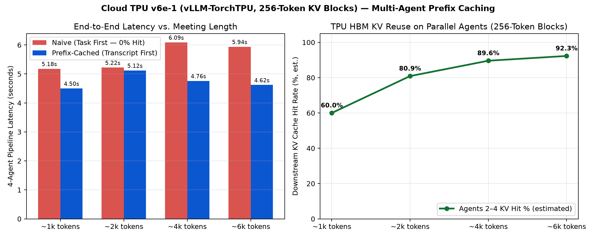
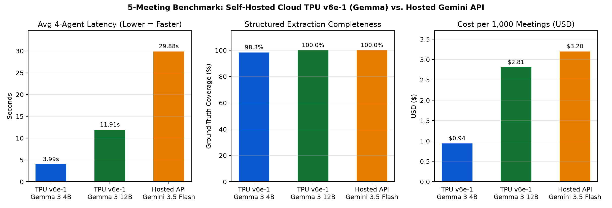
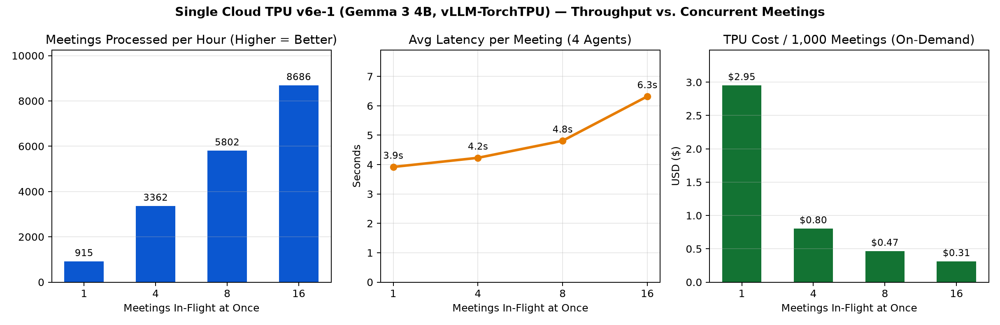

# Private Meeting Intelligence on Cloud TPUs

A multi-agent app that reads a meeting transcript and pulls out the summary, decisions, risks and action items as JSON. The model is Gemma 3, running on my own Cloud TPU v6e with vLLM-TorchTPU, so the meeting text never goes to an outside API.

I built this for a TPU sprint. I wanted to answer three questions:

1. Can I take an open model from install to a working TPU endpoint and plug an agent framework into it?
2. When four agents read the same transcript, can they share the work instead of each one starting from scratch?
3. How does this compare with a hosted API on quality, speed and cost?

All meetings in this repo are made up. No real company data is used.

## How it works

There are four agents, built with Google ADK:

- **InsightsAgent** writes a short summary and lists the key points.
- **DecisionsAgent** finds what was approved, rejected or postponed, and who owns it.
- **RisksAgent** finds the risks people raised, with a category and severity.
- **ActionsAgent** lists the follow-up tasks with an owner and a deadline.

They run in two steps. InsightsAgent goes first, on its own. Then the other three run at the same time.

The reason for this order: when a model reads a prompt, vLLM saves the processed result (the KV cache) in TPU memory. If the next prompt starts with the exact same text, that part can be reused instead of computed again. So every agent's prompt starts with the full transcript, and only the last line (the agent's task) is different. InsightsAgent fills the cache, and the other three reuse it.

```
transcript ──> InsightsAgent ──> DecisionsAgent ─┐
                (fills cache)    RisksAgent ─────┼──> JSON report
                                 ActionsAgent ───┘
                                 (reuse the cache, run in parallel)
```

The TPU server only listens on `127.0.0.1`. My laptop talks to it through an SSH tunnel, so nothing is open to the internet.

## Setup used

- Cloud TPU v6e-1 (one chip, 32 GB memory), zone `europe-west4-a`
- vllm-torchtpu 0.29.0, libtpu 0.0.50
- Gemma 3 4B and Gemma 3 12B (instruction-tuned) from Hugging Face
- Google ADK, with LiteLLM to connect it to the vLLM endpoint
- Hosted comparison: Gemini 3.5 Flash on Vertex AI

## Results

### 1. Does prompt order matter for cache reuse?

I ran the same meeting at four lengths, once with the agent's task at the top of the prompt and once with the transcript at the top. The hit rate comes from vLLM's own metrics.

| Meeting length | Task first: time | Task first: cache reuse | Transcript first: time | Transcript first: cache reuse |
|---|---:|---:|---:|---:|
| ~1k tokens | 5.18 s | 0% | 4.50 s | 45% |
| ~2k tokens | 5.22 s | 0% | 5.12 s | 61% |
| ~4k tokens | 6.09 s | 0% | 4.76 s | 67% |
| ~6k tokens | 5.94 s | 0% | 4.62 s | 69% |

With the task first, nothing was reused at all. With the transcript first, reuse went up with meeting length, reaching 69% on the longest meeting, and the whole run was up to 1.29x faster. Longer meetings do better because the TPU caches in blocks of 256 tokens, so a short prompt leaves a bigger uncached piece at the end.



The chart also shows an estimated reuse for the three parallel agents only (up to ~92%). That number is my estimate, assuming the first agent gets no reuse. The 69% is the measured one.

### 2. Small model, bigger model, or hosted API?

Five meetings, each with 3 decisions, 4 risks and 4 actions written into it (55 items total). Meetings were run one at a time.

| Model | Time per meeting | Items found | Cost per 1,000 meetings |
|---|---:|---:|---:|
| Gemma 3 4B on TPU | 3.99 s | 54 / 55 | $0.94 (Spot) / $2.99 (on-demand) |
| Gemma 3 12B on TPU | 11.91 s | 55 / 55 | $2.81 (Spot) / $8.93 (on-demand) |
| Gemini 3.5 Flash (hosted) | 16.2 s median | 55 / 55 | about $3.20 |

- The 4B model was about 4x faster than the hosted API's median time. It missed one risk in one meeting.
- The 12B model found everything, like Gemini, and still fit on a single TPU chip.
- Gemini's average was 29.9 s, but that includes one slow request of 85 s. That's why I report the median.

"Items found" only checks how many items came back, not whether each one is correct. The TPU cost is worked out from the hourly price and the measured speed. The Gemini cost is a rough estimate from token counts, not an actual bill.



### 3. What happens when many meetings come in at once?

This is where a TPU is supposed to shine: it can process many requests together in one batch. I sent 32 meetings at each level, with 1, 4, 8 or 16 of them running at the same time, all on one v6e-1 with Gemma 3 4B. Each meeting got a unique ID at the top, so different meetings could not reuse each other's cache.

| Meetings at once | Meetings per hour | Time per meeting | Cost per 1,000 (on-demand) | Cost per 1,000 (Spot) |
|---:|---:|---:|---:|---:|
| 1 | 915 | 3.9 s | $2.95 | $0.93 |
| 4 | 3,362 | 4.2 s | $0.80 | $0.25 |
| 8 | 5,802 | 4.8 s | $0.47 | $0.15 |
| 16 | 8,686 | 6.3 s | $0.31 | $0.10 |

Going from 1 to 16 meetings at once gave about 9.5x more meetings per hour on the same chip. Each meeting only took 2.4 seconds longer.



## What went wrong, and what I learned

- **Wrong Python version.** The TPU image comes with Python 3.10, but vllm-torchtpu needs 3.12. I used `uv` to install Python 3.12 separately. It took under a minute.
- **TPU caching is not the same as GPU caching.** vLLM on TPU uses 256-token cache blocks (GPUs use 16), and it turned on an 8-bit (fp8) cache by itself. That is how the 12B model fit on one 32 GB chip.
- **My first prompt layout shared nothing.** I first put each agent's task at the top of the prompt. That gave 0% reuse, because the first block was already different for every agent. Moving the transcript to the top fixed it.
- **Switching models got stuck.** When I tried to load the 12B model, it failed with "The TPU is already in use". The old vLLM process had renamed itself `VLLM::EngineCore`, so `pkill -f vllm` didn't find it. `sudo fuser -k /dev/vfio/0` freed the chip.
- **Startup is slow.** The server takes 2 to 3 minutes to start, mostly compiling for the TPU. Setting `--max-num-seqs` to what you actually need cuts this down.
- **My Spot TPU got shut down.** The cheaper Spot TPU was taken back by Google Cloud in the middle of a test. For anything real, keep at least one regular TPU.
- **The SSH tunnel drops idle connections.** In the first throughput run, a few requests failed with "Server disconnected", and those numbers were wrong. I added a retry and ran it again. Even then, 2 of 32 meetings failed at the one-at-a-time level. In a real setup the app should run inside the same network as the TPU, not over SSH.

## Limitations

- All meetings are synthetic. Several of them clearly label each decision and risk, which makes the job easier than a real meeting would.
- Quality is measured by counting items, not by checking that each item is correct.
- Costs are calculated, not billed.
- I did not compare against GPUs, so I'm not claiming a TPU is faster or cheaper than a GPU. I only compared it with a hosted API.

## Files

| File | What it does |
|---|---|
| `sample_meeting.txt`, `meetings/` | The synthetic meetings |
| `step1_tpu_setup_and_serve.sh` | Create the TPU, install vllm-torchtpu, serve Gemma |
| `step2_adk_pipeline.py` | The four-agent pipeline. Saves `meeting_output.json` |
| `step3_prefix_cache_experiment.py` | Result 1 (prompt order). Saves `prefix_cache_results.json` |
| `step4_compare_tpu_vs_gemini.py` | Result 2 (models). Saves `research_comparison.json` |
| `step5_generate_charts.py` | Draws the charts for results 1 and 2 |
| `step6_concurrency_benchmark.py` | Result 3 (many meetings at once). Saves `concurrency_results.json` and its chart |
| `demo_ui.py` | Streamlit demo |
| `BLOG_POST.md` | Blog draft and video outline |

## Running it

**Local setup**

```bash
python3 -m venv .venv
.venv/bin/pip install -r requirements.txt
cp .env.example .env   # then put your GCP project ID in .env
gcloud auth application-default login
```

**Demo.** Works without a TPU by using the hosted Gemini model. If the TPU tunnel is up, it uses the TPU.

```bash
.venv/bin/streamlit run demo_ui.py
```

**On a TPU.** Follow `step1_tpu_setup_and_serve.sh` to create the TPU, start the server and open the SSH tunnel. Then, on your laptop:

```bash
.venv/bin/python step2_adk_pipeline.py
.venv/bin/python step3_prefix_cache_experiment.py
.venv/bin/python step4_compare_tpu_vs_gemini.py --target tpu_4b
.venv/bin/python step6_concurrency_benchmark.py   # start the server with --max-num-seqs 64 for this one
.venv/bin/python step5_generate_charts.py
```

Delete the TPU as soon as you finish. A v6e-1 costs about $2.70 an hour on-demand, and it keeps charging while it sits idle.

```bash
gcloud compute tpus tpu-vm delete meeting-tpu --project=$PROJECT_ID --zone=europe-west4-a --quiet
```
